  

  
  

 

## Skills

#### Container & Orchestration

#### CI/CD & GitOps

#### Infrastructure as Code

#### MLOps

#### Monitoring & Observability

#### Programming Languages

 

## Certifications

<table>
  <tr>
    <td align="center" width="50%">
       
      AWS Certified Solutions Architect - Associate
    </td>
    <td align="center" width="50%">
       
      HashiCorp Certified: Terraform Associate (004)
    </td>
  </tr>
</table>

 

## Open Source Contributions

> Merged fixes in **Prometheus · node_exporter · OpenTofu · Helm** and more

#### Major Contributions

| 프로젝트 | 기여 내용 | PR |
|---|---|---|
|  [opentofu](https://github.com/opentofu/opentofu) | `tofu init -backend=false` 실행 시 암호화된 로컬 state 파일을 불필요하게 읽고 복호화를 시도하는 현상 수정 |  |
|  [prometheus](https://github.com/prometheus/prometheus) | `tracing.client_type: http`와 `insecure: true` 함께 사용시 프로메테우스 실행할 때 에러나는 현상 수정 |  |
|  [node_exporter](https://github.com/prometheus/node_exporter) | `--collector.diskstats.device-include` 단독 사용 시 device-exclude 기본값과의 충돌로 패닉이 발생하는 현상 수정 |  |
|  [fastexcel](https://github.com/dhatim/fastexcel) | `fastexcel-reader`가 엑셀 파일의 1904 날짜 체계를 정상적으로 인식하지 못하는 현상 수정 |  |
<!--
|  [tabulator](https://github.com/olifolkerd/tabulator) | 테이블을 임시적으로 DOM에서 제거한 상태에서 행을 추가하고 다시 렌더링할 때 행 추가 상태가 반영되지 않는 현상 수정 |  |
|  [filepond](https://github.com/pqina/filepond) | 데이터가 많아 스크롤이 생기는 환경에서 드래그 앤 드랍 소팅 시 드랍 포지션이 잘못 계산되는 현상 수정 |  |
-->

#### Documentation & Minor Fixes

| 프로젝트 | 기여 내용 | PR |
|---|---|---|
|  [helm-www](https://github.com/helm/helm-www) | Helm v4 문서 플러그인 섹션 한국어 번역 |  |
