

  <a href="https://mumberrymountain.github.io/jeon-resume-blog/"></a>

  
  
  

 

## Skills

#### Container & Orchestration
<a href="https://www.docker.com"></a><a href="https://kubernetes.io"></a><a href="https://kustomize.io"></a><a href="https://istio.io"></a>

#### CI/CD & GitOps
<a href="https://docs.gitlab.com/ee/ci/"></a><a href="https://github.com/features/actions"></a><a href="https://argo-cd.readthedocs.io"></a>

#### Infrastructure as Code
<a href="https://developer.hashicorp.com/terraform"></a><a href="https://www.ansible.com"></a>

#### MLOps
<a href="https://dvc.org"></a><a href="https://www.kubeflow.org"></a>

#### Monitoring & Observability

#### Programming Languages
<a href="https://www.python.org"></a><a href="https://www.gnu.org/software/bash/"></a>

 

## Certifications

<table>
  <tr>
    <td align="center" width="50%">
       
      AWS Certified Solutions Architect - Associate
    </td>
    <td align="center" width="50%">
       
      HashiCorp Certified: Terraform Associate (004)
    </td>
  </tr>
</table>

 

## Open Source Contributions

> Merged fixes in **Prometheus · node_exporter · OpenTofu · Helm** and more

<a href="https://github.com/opentofu/opentofu/pull/4077"></a>
<a href="https://github.com/prometheus/prometheus/pull/18469"></a>
<a href="https://github.com/prometheus/node_exporter/pull/3603"></a>
<a href="https://github.com/dhatim/fastexcel/pull/527"></a>
<a href="https://github.com/helm/helm-www/pull/2047"></a>

<!--
|  [tabulator](https://github.com/olifolkerd/tabulator) | 테이블을 임시적으로 DOM에서 제거한 상태에서 행을 추가하고 다시 렌더링할 때 행 추가 상태가 반영되지 않는 현상 수정 |  |
|  [filepond](https://github.com/pqina/filepond) | 데이터가 많아 스크롤이 생기는 환경에서 드래그 앤 드랍 소팅 시 드랍 포지션이 잘못 계산되는 현상 수정 |  |
-->
